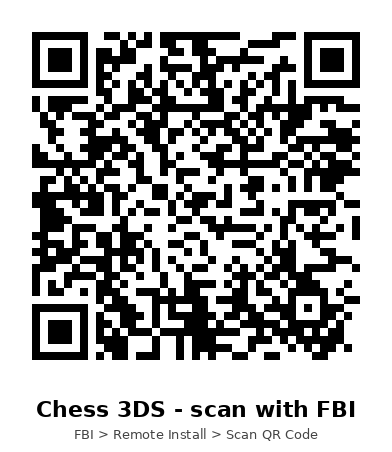

# Chess 3DS

A chess game for the Nintendo 3DS that uses both screens. You can play pass & play, against the CPU, or against a friend over local wireless.

| Screen | What's on it |
| --- | --- |
| **Top** | Player cards (whose turn it is, captured pieces, material lead), game status, and a scrolling move list in algebraic notation |
| **Bottom (touch)** | The board: tap or drag pieces. A side panel has Menu, Undo and Flip buttons |

## Features

- All the chess rules: castling, en passant, promotion (with a piece picker), check, checkmate and stalemate. Draws by the 50-move rule, threefold repetition and insufficient material.
- **Pass & Play**: two players on one 3DS. The board turns to face whoever is moving (you can switch this off in the menu).
- **vs CPU**: Easy, Medium or Hard, playing White, Black or a random color. The CPU thinks on a background thread, so the game doesn't freeze while it does.
- **Local Wireless multiplayer**: one 3DS hosts and the other joins. No internet needed. You get resign, draw offers and rematches, and colors swap every rematch.
- Shows legal moves, highlights the last move, marks a king in check, and animates moves.

## Install with FBI (QR code)

You need a 3DS with custom firmware and [FBI](https://github.com/lifehackerhansol/FBI) installed.

1. Make sure your 3DS is connected to the internet.
2. Open **FBI** → **Remote Install** → **Scan QR Code**.
3. Scan this code:

   

   It points to `https://raw.githubusercontent.com/Dipish3639/chess-3ds/ccr-7e8d3d53-wy1m3c/release/Chess3DS.cia`.

   Once this branch is merged into `main`, use [`release/qr-code-main.png`](release/qr-code-main.png) instead. It points at the same file on `main`.
4. Confirm the install. **Chess 3DS** will show up on the HOME Menu.

You can also download [`release/Chess3DS.cia`](release/Chess3DS.cia) and install it from your SD card with FBI. Or copy [`release/Chess3DS.3dsx`](release/Chess3DS.3dsx) to `/3ds/` and run it from the Homebrew Launcher.

## Controls

| Input | Action |
| --- | --- |
| Touch | Tap a piece, then tap where it should go. You can also drag it |
| D-Pad + A | Move the cursor and select or move a piece |
| B | Cancel the selection |
| X | Flip the board |
| Y | Undo (Pass & Play and vs CPU only) |
| START | Pause menu: undo, offer a draw, resign, flip, quit |

### Wireless play

Both players need Chess 3DS installed, and wireless must be on.

1. Player 1 picks **Host Wireless Game**.
2. Player 2 picks **Join Wireless Game**, then taps the host's game in the list.
3. The host plays White in the first game. Colors swap on every rematch.

## Building

You need Docker. This builds `chess3ds.3dsx` and `chess3ds.cia` inside the official `devkitpro/devkitarm` image. The first time it runs, it also compiles `makerom` and `bannertool` from source.

```sh
./build.sh
```

If you have devkitARM installed along with `makerom` and `bannertool` in your `PATH`, you can run `make` (3dsx only) or `make cia` instead.

To update the downloadable release after a build:

```sh
cp chess3ds.cia release/Chess3DS.cia
cp chess3ds.3dsx release/Chess3DS.3dsx
python3 tools/make_qr.py main release/qr-code-main.png   # needs: pip install qrcode pillow
```

### Project layout

```
source/chess.c   rules engine: move generation, legality, SAN, game end
source/ai.c      CPU player: alpha-beta search with quiescence and piece-square tables
source/net.c     local wireless (UDS): host/scan/join, reliable in-order messages
source/main.c    UI for both screens, input, and game flow
gfx/             piece sprites (made by tools/gen_assets.py)
assets/          banner, banner jingle and CIA RSF
tests/perft.c    move-generator test, run on your PC:
                 gcc -O2 -Isource tests/perft.c source/chess.c && ./a.out
```
